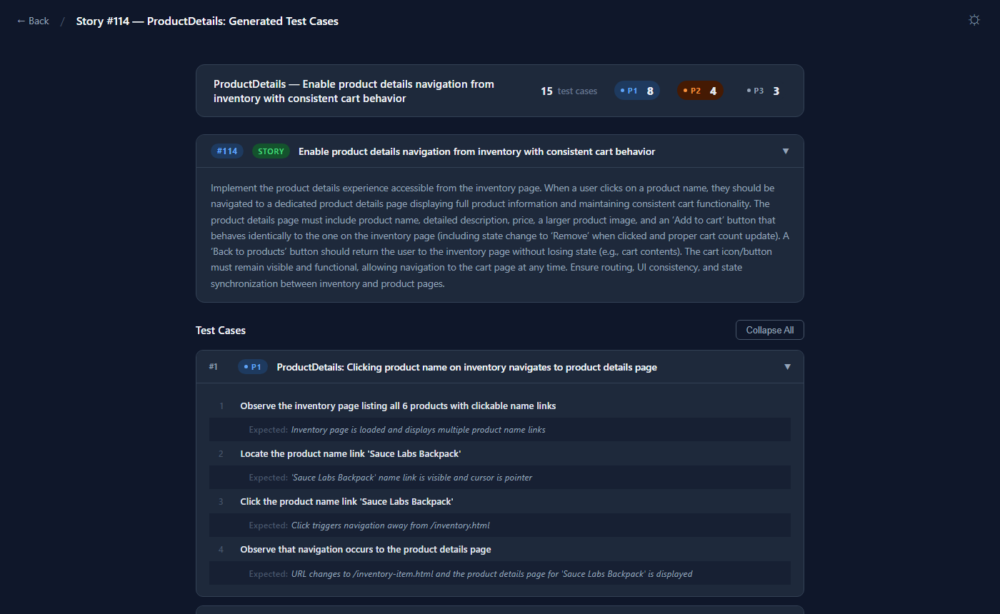
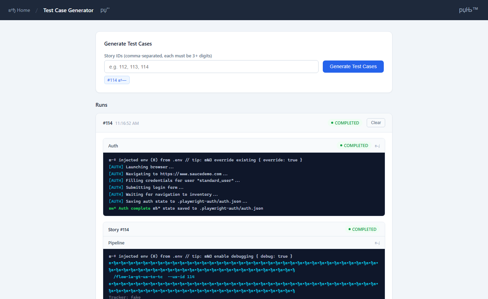

# User Story → Test Case Agent Generator

An AI-powered pipeline that converts user stories from your issue tracker into structured QA test cases. Claude AI agents explore the target app with Playwright, design test scenarios from acceptance criteria, and publish test cases back to your tracker.

The pipeline is exposed as a web UI and REST API backed by an Express.js server. In production the server runs behind an nginx reverse proxy.

---

## Prerequisites

- **Node.js 22+** and **npm**
- **Docker & Docker Compose** — for production or containerized dev
- **Claude Code** CLI installed and authenticated (`claude` in your PATH)

---

## Environment Setup

### 1. Copy the sample env file

```bash
cp .env.sample .env
```

### 2. Fill in values

```env
# Required — choose one tracker
ISSUE_TRACKER=fake            # fake | github | jira | ado | linear

# Required only when ISSUE_TRACKER=fake
FAKE_TRACKER_URL=http://localhost:3000

# Target app credentials (used by Playwright auth)
APP_URL=https://www.saucedemo.com
APP_USERNAME=standard_user
APP_PASSWORD=secret_sauce

# Server
SERVER_PORT=4000              # default 4000
NODE_ENV=development          # development | production

# Optional: set to enable API key auth on /api/* routes
API_KEY=

# Optional: tune pipeline timeouts (milliseconds)
# JOB_TIMEOUT_MS=2400000      # default 40 min per story
# BATCH_TIMEOUT_MS=3600000    # default 60 min per batch
```

> **Note:** `FAKE_TRACKER_URL` is only required when `ISSUE_TRACKER=fake`. For GitHub/Jira/ADO/Linear you can leave it unset.

---

## Running Locally (Express, no Docker)

### Install dependencies

```bash
npm install
```

### Option A — Development with hot reload

```bash
npm run dev
```

Uses `tsx --watch`. The server restarts automatically on any file change in `server/`, `helpers/`, or `scripts/`. Reads `.env` from the project root.

```
[INFO] Server started {"port":4000,"env":"development"}
```

### Option B — One-shot start (no watch)

```bash
npm run server
```

Same as dev mode but without file watching. Useful for short-lived local runs.

### Verify the server is up

```bash
curl http://localhost:4000/health
# {"status":"ok","uptime":12.3}
```

Open **http://localhost:4000** in your browser to reach the web UI.

---

## Running in Production (nginx + Docker)

The production stack runs two containers: the Node.js app on an internal port (not exposed to the host) and an nginx reverse proxy on port 80 (publicly exposed). nginx waits for the app health check to pass before accepting traffic.

### Step 1 — Set environment

Edit `.env` and set:

```env
NODE_ENV=production
ISSUE_TRACKER=fake          # or your real tracker
FAKE_TRACKER_URL=...        # only if ISSUE_TRACKER=fake
API_KEY=changeme            # recommended in production
```

### Step 2 — Build the production image

```bash
npm run docker:build
# Equivalent to: docker build -t us-tc-generator .
```

This runs a two-stage Docker build:
- **Stage 1 (builder):** Installs all deps, compiles TypeScript to `dist/`, copies static HTML
- **Stage 2 (runner):** Fresh Node 22 Alpine image, installs production deps only, copies `dist/`

### Step 3 — Start the stack

```bash
docker compose -f docker-compose.prod.yml up -d
```

Services started:

| Service | Image | Exposed |
|---|---|---|
| `app` | `us-tc-generator:latest` | Internal :4000 only |
| `nginx` | `nginx:alpine` | Host port 80 |

### Step 4 — Verify

```bash
# Health check through nginx
curl http://localhost/health
# {"status":"ok","uptime":...}

# Security headers from nginx
curl -I http://localhost/
# X-Content-Type-Options: nosniff
# X-Frame-Options: SAMEORIGIN
# Referrer-Policy: strict-origin-when-cross-origin

# Config endpoint (requires API_KEY header if API_KEY is set)
curl -H "X-API-Key: changeme" http://localhost/api/config
# {"issueTracker":"fake","trackerUrl":"http://localhost:3000"}
```

### Persistent volumes

Two named Docker volumes survive `docker compose down` and persist across deployments:

| Volume | Container path | Contents |
|---|---|---|
| `playwright-auth` | `/app/.playwright-auth` | Playwright browser auth sessions |
| `workflow-artifacts` | `/app/.workflow-artifacts` | Pipeline run artifacts (JSON, screenshots) |

### Stop the stack

```bash
docker compose -f docker-compose.prod.yml down
# Add -v to also remove named volumes (destructive — loses saved auth and artifacts)
```

---

## Development via Docker (hot reload)

For a containerized dev environment with full hot reload:

```bash
npm run docker:dev
# Equivalent to: docker-compose up --build
```

Mounts the entire project directory into the container and runs `tsx --watch`. Port 4000 is forwarded to the host. Use this when you want dev parity with the production OS (Linux/Alpine) without sacrificing iteration speed.

---

## Authenticate with the Target App

The pipeline uses a saved Playwright browser session to log in to your app during exploration. Generate this session before the first pipeline run and whenever it expires:

```bash
npm run auth
```

This launches a headless Chromium browser, logs in to `APP_URL` using `APP_USERNAME` / `APP_PASSWORD` from `.env`, and saves the session to `.playwright-auth/auth.json`.

> **In production Docker:** The auth file lives in the `playwright-auth` named volume. Run `npm run auth` on the host and copy the resulting file into the container, or `docker exec` into the app container and run it there.

---

## Running the Pipeline (CLI)

```bash
npm run us:to:tc <story-id>
```

Example:

```bash
npm run us:to:tc 112
```

The pipeline runs end-to-end autonomously:

1. **Story planner** — fetches story 112 from the tracker, explores the app with Playwright, writes `scenarios.md`
2. **Bug reporter** — if bugs are found during exploration, files them to the tracker automatically
3. **Test ideation** — expands scenarios into structured test design units, writes `test-ideas.json`
4. **Test case generator** — publishes each scenario as a tracker test case, links them back to story 112

Progress is streamed to the terminal with colored phase compacts. Artifacts land in `.workflow-artifacts/gtc-<timestamp>/`.

### Pipeline environment

The CLI runner passes these env vars to the agent subprocess:

| Var | Source |
|---|---|
| `ISSUE_TRACKER` | `.env` |
| `FAKE_TRACKER_URL` | `.env` (only when tracker is `fake`) |

`APP_URL`, `APP_USERNAME`, `APP_PASSWORD` are read by `helpers/auth.ts` during the auth step.

---

## Web UI + REST API

With the server running, open **http://localhost:4000** (local) or **http://your-host** (production).

### Endpoints

| Method | Path | Auth | Description |
|---|---|---|---|
| `GET` | `/health` | None | Health check |
| `GET` | `/api/config` | API key | Active tracker config |
| `POST` | `/api/batches` | API key | Start a batch `{"storyIds":["112","113"]}` |
| `GET` | `/api/batches` | API key | List all batches |
| `GET` | `/api/batches/:id/stream` | API key | SSE stream for live batch progress |
| `DELETE` | `/api/batches/:id` | API key | Cancel a running batch |
| `DELETE` | `/api/batches/:id/clear` | API key | Remove a completed batch |
| `DELETE` | `/api/batches/:batchId/jobs/:storyId` | API key | Cancel one job in a batch |

### API key auth

Set `API_KEY=mysecret` in `.env` to require auth on all `/api/*` routes.

Pass the key via:
- Header: `X-API-Key: mysecret`
- Query param: `?apiKey=mysecret` (used by SSE `EventSource` clients that cannot set headers)

---

## Developer Scripts

| Command | Description |
|---|---|
| `npm run dev` | Start server with hot reload (`tsx --watch server/local.ts`) |
| `npm run server` | Start server once, no watch |
| `npm run build` | Compile TypeScript → `dist/` (`tsc -p tsconfig.server.json`) |
| `npm start` | Run compiled build (`node dist/server/production.js`) |
| `npm run auth` | Playwright login — saves session to `.playwright-auth/auth.json` |
| `npm run us:to:tc <id>` | Run the full pipeline for a story ID |
| `npm run docker:dev` | Containerised dev with hot reload (`docker-compose up --build`) |
| `npm run docker:build` | Build production Docker image (`us-tc-generator:latest`) |
| `npm run typecheck` | TypeScript type check with no emit |
| `npm run lint` | ESLint on `server/`, `scripts/`, `helpers/` |
| `npm run format` | Prettier on `server/`, `scripts/`, `helpers/` |

---

## Project Structure

```
.
├── server/
│   ├── app.ts              Express factory — middleware + routes
│   ├── bootstrap.ts        Server startup, SIGTERM/SIGINT, graceful shutdown
│   ├── local.ts            Dev entry point → startServer(localConfig)
│   ├── production.ts       Prod entry point → startServer(prodConfig)
│   ├── logger.ts           JSON logger (prod) / coloured logger (dev)
│   ├── types.ts            Batch, Job, status type definitions
│   ├── config/
│   │   ├── base.ts         Env var helpers, AppConfig interface, buildBaseConfig()
│   │   ├── index.ts        Dynamic re-export based on NODE_ENV
│   │   ├── local.ts        nodeEnv: "development"
│   │   └── production.ts   nodeEnv: "production"
│   ├── middleware/
│   │   ├── apiKey.ts       Optional API key auth (header or query param)
│   │   └── errorHandler.ts Global error handler — must be last middleware
│   ├── routes/
│   │   ├── batches.ts      Batch CRUD endpoints
│   │   ├── config.ts       /api/config + static HTML serving
│   │   └── sse.ts          SSE stream with state replay + keep-alive
│   ├── services/
│   │   ├── batchRunner.ts  runBatch, startJob, cancelBatch, cancelJob, finalizeBatch
│   │   ├── batchStore.ts   In-memory Map + createBatch() factory + serializer
│   │   ├── sseManager.ts   formatSSEMessage() + sendSSE() broadcast
│   │   └── processManager.ts  spawnLines(), killProcess(), stripAnsi()
│   └── public/
│       ├── index.html      Main web UI
│       └── generate.html   Test generation form
├── helpers/
│   ├── auth.ts             Playwright login — saves .playwright-auth/auth.json
│   └── getEnvVars.ts       CLI env loader (separate from server config)
├── scripts/
│   ├── run-pipeline.ts     Claude Agent SDK query() runner
│   └── utils/colors.ts     ANSI formatting + phase compact detection
├── nginx/
│   └── nginx.conf          Reverse proxy, SSE unbuffering, security headers
├── .claude/skills/         Agent pipeline skills (gt-*, ft-*, flow-*)
├── .workflow-artifacts/    Pipeline run outputs — gitignored
├── Dockerfile              Multi-stage: builder → slim runner (Node 22 Alpine)
├── docker-compose.yml      Dev: hot reload + volume mount
├── docker-compose.prod.yml Prod: app + nginx + named volumes + health check
├── tsconfig.json           Base TypeScript config (ES2022, strict, commonjs)
├── tsconfig.server.json    Server build config (outputs to dist/)
├── tsconfig.scripts.json   Scripts build config
└── .env.sample             All env vars with comments
```

---

## run_examples/

Saved example outputs from a real pipeline run against [SauceDemo](https://www.saucedemo.com/) (story #114 — ProductDetails). Open the HTML files directly in a browser — no server required.

| File | Description |
|---|---|
| `TC Generator Process.html` | Saved snapshot of the generator web UI during the live story #114 run. Shows the full streaming pipeline log: auth, story planner, app exploration, test ideation, and all 15 TC generation steps. |
| `Generated TCs.html` | Hardcoded display of the 15 test cases produced for story #114. Collapsible cards with priority badges (P1/P2/P3), step-by-step actions, and expected results. Dark/light theme toggle included. |

**Generated TCs** — story card, priority breakdown, and collapsible test case steps:



**TC Generator Process** — web UI with live pipeline log (auth → story planner → ideation → TC creation):



---

## Architecture Overview

```
Browser / curl
      │
      ▼
  nginx :80                  ← reverse proxy, security headers, gzip
      │
      ▼
  Express :4000
  ├── GET  /health            no auth
  ├── static /public          no auth
  └── /api/*                  optional API key auth
       ├── POST /api/batches   → createBatch() → runBatch()
       │                            │
       │                    ┌───────▼────────┐
       │                    │  batchRunner   │
       │                    │  auth → jobs   │
       │                    │  spawnLines()  │ ← spawns tsx run-pipeline.ts
       │                    └───────┬────────┘
       │                            │ SSE events
       └── GET /api/batches/:id/stream ← EventSource (browser)
```

**Pipeline subprocess flow (per story):**

```
npm run us:to:tc <id>
  └── Claude Agent SDK (query)
        └── /flow-1a-gt-us-to-tc
              ├── gt-story-planner      → us.json, scenarios.md
              ├── playwright-cli        → exploration.json
              ├── [ft-bug-reporter]     → bug-{i}.json  (if bugs found)
              ├── gt-test-ideation      → test-ideas.json
              └── gt-test-case-generator → tc-N.json, tc-steps-N.md/xml
```
