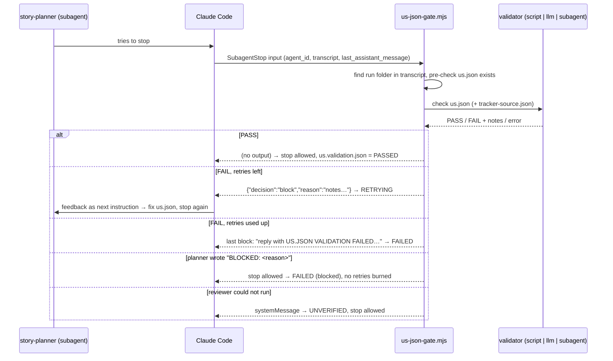

# Feedback loops: gt-story-planner → us.json

A study of the `us.json` feedback loop: how it works, what good practice looks like, what the first
test runs in this folder did and did not prove, and a repeatable test set for all three validators.

## 1. How the loop works

`gt-story-planner` runs as the `story-planner` subagent. When it tries to finish, Claude Code fires a
`SubagentStop` hook (`.claude/hooks/us-json-gate.mjs`). The gate checks `us.json` and either lets the
stop through or **blocks** it. A block puts the feedback into the planner's context as its next
instruction, so the planner fixes `us.json` and tries to stop again.



Every gate call is logged to `.workflow-artifacts/.hook-state/us-json-gate.log`, and the latest
status is written to `<run>/us.validation.json`.

## 2. The three validators

Exactly one validator is active: the `--mode` in `.claude/settings.json`.

| | `script` | `llm` | `subagent` |
|---|---|---|---|
| Code | `lib/validate-us-json.mjs` | `lib/review-us-json-llm.mjs` | `lib/review-us-json-subagent.mjs` |
| How | deterministic JS | one Agent SDK call, no tools, both files pasted into the prompt | `claude -p --agent us-json-reviewer`, which reads the files with the Read tool |
| Rules | the code | body of `.claude/agents/us-json-reviewer.md` | the same `.md` (body, tools, model) |
| Sees | types and shape, plus "tracker-source.json exists" | shape, plus **fidelity** to `tracker-source.json`, placeholders, duplicates | same as llm |
| Time per check (measured) | ~0.1 s, free | 15–32 s (Sonnet via Agent SDK `query()`) | 5–8 s (Sonnet via `claude -p`) |
| Failure mode | blind to meaning (see results) | model error → `UNVERIFIED`; may be too strict or too lenient | same, plus CLI missing or timeout → `UNVERIFIED` |

**Takeaway:** script checks are cheap and certain but only see structure. The LLM reviewers see
meaning, but they cost time and money and have to be tested themselves. In production you would
layer them: script first, then the LLM only when the script passes (see §9).

## 3. Best-practices checklist

| # | Practice | Where it comes from | Status |
|---|---|---|---|
| 1 | Limit retries and always end in a final state | CC hooks docs (8-continuation cap) | ✓ `MAX_RETRIES = 3`, final report block, `reported` flag |
| 2 | Detect conditions that can't be fixed and stop early | CC hooks docs: *"check `stop_hook_active` or process the transcript to avoid blocking on a condition that will never resolve"*; prompt hooks' `impossible` | ✓ **new**: `BLOCKED: <reason>` |
| 3 | Run deterministic checks for structure; use an LLM only for content judgment | LLM-as-judge guides | partial: the modes are exclusive (see §9) |
| 4 | Judge against ground truth | evaluator-optimizer pattern | ✓ `tracker-source.json` is verbatim and never edited |
| 5 | One specific fix per problem, never one that drops or fabricates data | reward-hacking risk | ✓ **new**: reviewer output rules |
| 6 | Narrow evaluator with a binary verdict | LLM-as-judge guides | ✓ PASS/FAIL JSON schema |
| 7 | Test the evaluator on labeled examples; re-test when the prompt or model changes | evals practice (TPR/TNR) | ✓ **new**: `npm run test:us-gate` |
| 8 | Decide explicitly what a reviewer outage does | general | ✓ `UNVERIFIED`: stop allowed, not counted as a retry |
| 9 | Make every status a clean final state; never treat in-progress as done | general | ✓ **new**: flow-1a aborts on `RETRYING` |
| 10 | Record what was checked, by what, and how long it took | general | ✓ log + `checked_by` (now honest about pre-checks) + timings in the test runner |
| 11 | Unit-test the gate offline with fixtures | general | ✓ **new**: 12 cases |

## 4. Review of the first test runs (the `llm/`, `script/`, `subagent/` folders)

Verdict: **not good enough on their own.** They prove two things: script mode passes a good story
(114), and the gate ends after 3 retries when `us.json` is never written (111). They do not show the
llm or subagent validators judging anything, and they never show the loop closing (fail → fix → pass).

1. **No model was called in the llm and subagent runs.** Story 111 is empty, so the planner wrote no
   `us.json`. The gate returned "not found" *before* reaching the validator. The log shows blocks
   3–4 s apart, too fast for a model review. The old `checked_by: "llm call"` was misleading
   (fixed: it now says `gate pre-check (us.json missing)`).
2. **No run closed the loop.** Nothing went FAIL → fixed → PASSED with `retries ≥ 1`.
3. **The only PASS used the validator that can't see the risk.** 114 has no tracker ACs, so the
   planner derived 6 from the description. Only llm/subagent can check that they aren't invented, and
   that PASS ran in script mode.
4. **Retries were burned on a problem nobody could fix.** The planner was told "if you can't fix it,
   say so", but saying so changed nothing, so 111 cost 4 extra turns (fixed: `BLOCKED:`).
5. **The most useful evidence was not committed.** Log lines 1–3 (run `gtc-20261111-111111`, id masked) are the
   only real subagent review. It caught a real problem (no `tracker-source.json`), but it offered
   "either restore the file **or** set id to manual and url to null". The second option damages the
   data just to get past the gate. The run never converged and was left at `RETRYING` (fixed: one fix
   per note, rule 14, script check D3b, and the llm prompt no longer labels a missing source as a
   "pasted story").
6. **A leftover `RETRYING` counted as done.** flow-1a only aborted on `FAILED`, so an interrupted run
   would have been resume-skipped with a `us.json` already known to be invalid (fixed: abort on
   `RETRYING`; resume only on `PASSED`/`UNVERIFIED`).

## 5. What changed

| ID | Change | Files |
|---|---|---|
| D1 | `checked_by` says `gate pre-check (...)` when no validator ran | `.claude/hooks/us-json-gate.mjs` |
| D2 | A `BLOCKED: <reason>` line in the planner's final message → `FAILED` at once, stop allowed | `us-json-gate.mjs`, `.claude/agents/story-planner.md`, `gt-story-planner/SKILL.md` |
| D3 | Reviewer: one fix per note; never drop or fabricate data; `id` must be a JSON string; rule 14 for a missing `tracker-source.json`. The llm prompt states the fact only | `.claude/agents/us-json-reviewer.md`, `lib/review-us-json-llm.mjs` |
| D3b | Script check: a tracker story with no `tracker-source.json` → one note: restore it | `lib/validate-us-json.mjs` |
| D4 | flow-1a aborts on `RETRYING`; resume-skips only on `PASSED`/`UNVERIFIED` | `flow-1a-gt-us-to-tc/SKILL.md`, `CLAUDE.md` |

## 6. Test cases

```bash
npm run test:us-gate                       # mode from .claude/settings.json (what the live hook uses)
npm run test:us-gate -- --mode llm         # one-off override: script | llm | subagent
npm run test:us-gate -- --verbose          # print every gate call and its feedback
npm run test:us-gate -- --case t3          # only cases whose name contains "t3"
```

No planner runs; the test runner plays the planner. For each fixture in
`.claude/hooks/test/fixtures/us-json/<case>/`, it copies `us.json` and `tracker-source.json` into a
temporary run folder and writes a fake subagent transcript pointing at it. It then pipes a
`SubagentStop` input into the real gate. After a BLOCK it writes `us.fixed.json` (if present) and
stops again. That is how the loop closing is tested. Everything it creates is removed afterwards.
Gate log lines stay, with `agent_id` starting `harness-`.

| Case | What's wrong | Rule | Expected: script | Expected: llm / subagent |
|---|---|---|---|---|
| `t1-valid-114` | nothing (ACs derived, tracker `acl` empty) | — | PASS | PASS |
| `t2-numeric-id` | `"id": 114` (number) → fixed | 1 | BLOCK → PASS | BLOCK → PASS |
| `t2-empty-ac` | `"ac": []` → fixed | 4 | BLOCK → PASS | BLOCK → PASS |
| `t3-summarized-description` | description rewritten as one sentence → fixed | 9 | PASS *(blind spot)* | BLOCK → PASS |
| `t3-invented-ac` | extra "Share via email" AC | 11 | PASS *(blind spot)* | BLOCK |
| `t4-placeholder-ac` | an AC is `"TBD"` | 12 | PASS *(blind spot)* | BLOCK |
| `t4-duplicate-ac` | an AC repeated word for word | 13 | PASS *(blind spot)* | BLOCK |
| `t5-no-us-json` | story 111 is empty, no us.json, no `BLOCKED:` | pre-check | BLOCK×3 → FINAL → STOP | same (no model call) |
| `t5-no-us-json-blocked` | same, planner ends with `BLOCKED: …` | D2 | BLOCKED | BLOCKED |
| `t5-missing-tracker-source` | tracker story, ground-truth file missing | 14 / D3b | BLOCK (1 note) | BLOCK |
| `t6-reviewer-error` | `CLAUDE_BIN` points nowhere | — | skipped | subagent: UNVERIFIED; llm: skipped |
| `t7-manual` | pasted story (`id: "manual"`, `url: null`) | — | PASS | PASS |

A *blind spot* row is labeled as passing on purpose: it documents what script mode cannot see. For
llm/subagent, a mismatch is reported as a **false pass** (missed a labeled defect) or a **false
fail** (flagged a correct file). That is how the evaluator itself gets evaluated.

## 7. Results

Measured with `npm run test:us-gate -- --verbose` (`--mode` override for llm and subagent).

| Case | script | subagent | llm |
|---|---|---|---|
| `t1-valid-114` | ✓ PASS | ✓ PASS (8.3 s) | ✓ PASS (31.0 s) |
| `t2-numeric-id` | ✓ BLOCK → PASS | ✓ BLOCK → PASS | ✓ BLOCK → PASS |
| `t2-empty-ac` | ✓ BLOCK → PASS | ✓ BLOCK → PASS | ✓ BLOCK → PASS |
| `t3-summarized-description` | ✓ PASS *(blind spot)* | ✓ BLOCK → PASS | ✓ BLOCK → PASS |
| `t3-invented-ac` | ✓ PASS *(blind spot)* | ✓ BLOCK | ✓ BLOCK |
| `t4-placeholder-ac` | ✓ PASS *(blind spot)* | ✓ BLOCK | ✓ BLOCK |
| `t4-duplicate-ac` | ✓ PASS *(blind spot)* | ✓ BLOCK | ✓ BLOCK |
| `t5-no-us-json` | ✓ BLOCK×3 → FINAL → STOP | ✓ same, ~70 ms per call (no model) | ✓ same, ~60 ms per call (no model) |
| `t5-no-us-json-blocked` | ✓ BLOCKED | ✓ BLOCKED | ✓ BLOCKED |
| `t5-missing-tracker-source` | ✓ BLOCK, 1 note | ✓ BLOCK, 1 note | ✓ BLOCK, 1 note |
| `t6-reviewer-error` | skipped | ✓ UNVERIFIED (84 ms) | skipped |
| `t7-manual` | ✓ PASS | ✓ PASS | ✓ PASS |
| **Total** | **11/11**, 17 calls, ~2 s | **12/12**, 19 calls, 72 s | **11/11**, 18 calls, 305 s |

**script, before the fixes:** 8/11. The three mismatches were exactly the problems from §4:
`t5-no-us-json` claimed `checked_by: "script (validate-us-json.mjs)"` for a check no validator ran;
`t5-no-us-json-blocked` was blocked again despite the planner's `BLOCKED:` line;
`t5-missing-tracker-source` was a **false pass** (no ground truth, and nothing noticed). After the
fixes: 11/11.

**subagent:** every labeled defect was caught and every correct file passed (no false passes, no
false fails). Each note gave one fix, for example:
- t2-numeric-id: `id: value is the JSON number 114 → write it as the string "114"`
- t3-invented-ac: `ac: last item "…'Share via email' button…" introduces UI/behavior … the source description never states → remove this item`
- t5-missing-tracker-source: `tracker-source.json: missing → re-run get.sh --id 114 and save its verbatim output next to us.json`
  (before rule 14, a real review of this case offered "or set id to manual", see §4.5).

**llm:** this was the **first time the llm validator ever ran** (§4.1), and it works: every labeled
defect was caught and every correct file passed. It gave the same single "restore
tracker-source.json" note as the subagent for the missing-source case.

### What the numbers teach

- **The pre-check cost the same in every mode.** In subagent and llm mode, `t5-no-us-json` takes
  ~70 ms per call, because no model is ever called for a missing file. That is why the first llm and
  subagent runs proved nothing about the reviewers.
- **"Single LLM call" is not the same as "fast".** The llm mode was ~3–4× slower per check than the
  subagent mode here (15–32 s vs 5–8 s), even though it has no tools. Both start a Claude Code
  process. The difference was not investigated, but it shows you should measure instead of assume.
- **Reviewers start writing the answer.** For `t2-empty-ac` both reviewers listed replacement ACs in
  their note. That helps the author, but if the author copies them, the reviewer has effectively
  written part of the artifact and nobody independent checked it. Worth watching for: the next
  review is then judging its own suggestion.
- **Blind spots are a design choice, not a bug.** The 4 script blind spots are why script mode is
  the cheap first layer, not the only check.

## 8. End-to-end reruns (with the real planner)

The test set checks the gate and validators. To also see the planner react to feedback:

1. Set `--mode` in `.claude/settings.json` and start a **new** Claude Code session (hooks load at
   session start).
2. Run `/gt-story-planner 114` (passes) and `/gt-story-planner 111` (should now end with `BLOCKED:`
   and `us.validation.json` → `FAILED`, `blocked` set, `retries: 0`).
3. Keep as evidence: the final message, `us.validation.json`, **and** the matching lines from
   `.workflow-artifacts/.hook-state/us-json-gate.log` (they show every attempt, its notes, and the
   time between attempts, which shows whether a model actually ran).

## 9. Next steps (not built)

- **Layered mode:** run the script first (fast, free) and call the llm only if it passes. Structural
  errors never cost a model call, and fidelity is still checked.
- **Deterministic fidelity:** rules 7–10 (`id`, `title`, `description`, `url` equal to the tracker
  source) are exact comparisons and could move into the script. Only rule 11 (derived ACs) and the
  near-duplicate check really need a model.
- **Native hooks:** Claude Code has `type: "prompt"` and `type: "agent"` hooks that return
  `{ok, reason}` (prompt hooks also return `impossible`). They need much less code, but have no retry
  counter, no `us.validation.json`, and no control over what is pasted in. The custom gate exists for
  those three things.

## Sources

- [Claude Code hooks reference](https://code.claude.com/docs/en/hooks): `SubagentStop` input, `decision: "block"`, `stop_hook_active`, the 8-continuation cap, `last_assistant_message`, prompt/agent hooks
- [Anthropic, Building effective agents](https://www.anthropic.com/research/building-effective-agents): the evaluator-optimizer workflow
- [Hamel Husain's evals skills, validate-evaluator](https://skills.sh/hamelsmu/evals-skills/validate-evaluator): validating a judge against labeled data (TPR/TNR)
- [Arize, LLM as a Judge](https://arize.com/guides/llm-as-a-judge/)
