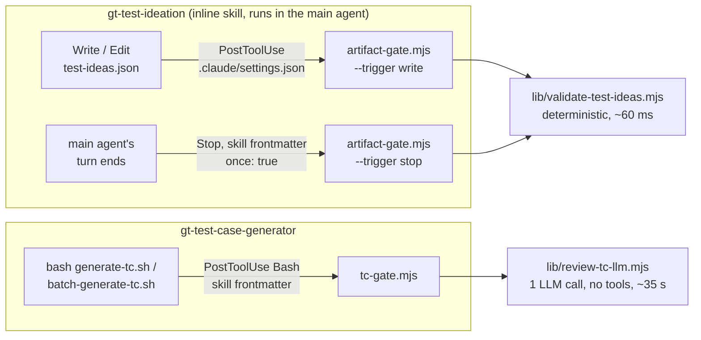

# Feedback loops: gt-test-ideation (write / stop) and gt-test-case-generator (LLM call)

The companion to [README.md](README.md), which covers the us.json loop. This doc studies the other three loops
the same way: a best-practice checklist, a review of the evidence, a labeled offline test set, fixes, and
measured results. Each loop keeps its approach, because the loops exist to compare loop styles.

## 1. The three loops



| Loop | What a failing check does | Status file |
|---|---|---|
| **write** | `{"decision":"block","reason":…}`: the notes appear **next to the Write result**. The file is already written, and the agent may fix it or move on | `test-ideas.validation.json` |
| **stop** | stderr + exit 2: the turn **cannot end**, and the notes become the agent's next instruction | same |
| **tc** | `{"decision":"block","reason":…}` **next to the script output**. Fix = delete the `tc-N` files and re-run the script (never hand-edit) | `tc.validation.json` |

The write/stop switch is `"trigger"` in `.claude/hooks/artifact-gate.json` (live: `write`). The other trigger
exits as `INACTIVE`.

## 2. All six loop variants side by side

| | us.json script | us.json llm | us.json subagent | test-ideas **write** | test-ideas **stop** | **tc** |
|---|---|---|---|---|---|---|
| Hook | SubagentStop | SubagentStop | SubagentStop | PostToolUse Write/Edit | Stop (main agent) | PostToolUse Bash |
| Registered in | settings.json | settings.json | settings.json | settings.json | skill frontmatter, `once` | skill frontmatter |
| Validator | deterministic | 1 LLM call | agent with Read | deterministic | deterministic | 1 LLM call |
| Can it **force** a fix? | yes | yes | yes | no (advice) | yes | no (advice) |
| Way out for unfixable input | `BLOCKED:` | `BLOCKED:` | `BLOCKED:` | agent stops → `RETRYING` | `BLOCKED:` *(new)* | agent stops → `RETRYING` |
| Judges work in progress? | no | no | no | **yes**, every write | no, final version only | no, after each script run |
| Inside flow-1a | runs | runs | runs | runs | skips itself | runs |
| flow-1a on failure | abort | abort | abort | abort | (never runs) | continue, report *(new)* |
| Time per check (measured) | ~0.1 s | 15–32 s | 5–8 s | ~0.06 s | ~0.06 s | ~32–36 s |

**The main lesson of this table:** *where* the hook fires decides what the loop can do.
- A **Stop-type hook** can force the fix. It therefore needs a way out for problems nobody can fix (`BLOCKED:`) and a hard cap.
- A **PostToolUse hook** can only advise. The caller has to treat a leftover `RETRYING` as "not done" (flow-1a aborts Phase 2 on it), or the advice is lost.

## 3. Best-practices checklist, per loop

The same 11 practices as README.md §3, plus one that only matters for LLM judges (#12).

| # | Practice | write | stop | tc |
|---|---|---|---|---|
| 1 | Limit retries; always reach a final state | ✓ | ✓ exit-2 blocks keep the `once` hook (docs) | ✓ |
| 2 | Stop early on problems nobody can fix | n/a: an advice hook forces nothing | ✓ **new** `BLOCKED:` | n/a, same as write |
| 3 | Deterministic checks for structure, LLM for meaning | ✓ deterministic (content blind spots labeled) | ✓ | ✗ by design: 8 exact-match criteria judged by an LLM (kept, measured) |
| 4 | Judge against ground truth | ✓ **new**: missing `scenarios.md`/`us.json` fails instead of passing | ✓ | ✓ test-ideas units are pasted in |
| 5 | One problem → one note → one fix; never drop or fabricate data | ✓ **new**: paraphrased heading = 1 note | ✓ | ✓ "one note per violation, never hand-edit" |
| 6 | Narrow, binary evaluator | ✓ | ✓ | ✓ JSON schema; test design is explicitly out of scope |
| 7 | Test the evaluator on labeled examples | ✓ **new** 15 cases | ✓ **new** | ✓ **new** 16 cases incl. probes |
| 8 | Explicit fail-open policy | ✓ gate crash → allow + message | ✓ | ✓ `UNVERIFIED`, not a retry |
| 9 | Every status is a clean final state, and it reaches a human | ✓ flow-1a aborts on `RETRYING` | ✓ | ✓ **new**: flow-1a's final summary reports it |
| 10 | Record what was checked, by what, and how long it took | ✓ + skipped checks now visible on PASS | ✓ + `NO_ARTIFACT` explains `once` | ✓ **new** `review_ms`, `cached` |
| 11 | Offline unit tests of the gate | ✓ **new** | ✓ **new** | ✓ **new** |
| 12 | Same input → same verdict (no re-rolling the judge) | n/a (deterministic) | n/a | ✓ **new** verdict cache |

## 4. Findings

**Both gates**

1. **Nothing was repeatable, and the tc loop had never run.** `.hook-state/` had no `tc-gate.log`, so the LLM reviewer had judged nothing. The artifact-gate evidence was one hand run (`session_id: "manual-gate-check"`) and one interactive session with a hand-injected 5-vs-6 length defect.
2. **The retry counter never reset after a PASS.** The log of that session shows: BLOCK retry 1 → PASSED → BLOCK **retry 2** → PASSED with `retries: 2`.
   - The status claimed 2 retries for a file fixed in one.
   - Every later, unrelated edit in the session used up the budget.

   Claude Code's own stop-hook cap counts *consecutive* continuations and resets. Fixed in both gates (S1).

**test-ideas (both triggers)**

3. **Missing ground truth was a silent PASS.** With no `scenarios.md` or `us.json` in the run folder, the coverage and AC checks were skipped. The warning went only into the status file, and the gate printed nothing. This is the same class of problem as us.json's D3b, and the most likely real cause is writing `test-ideas.json` into a new run folder.
4. **One problem gave two notes, and one of them was an either/or fix.** A paraphrased scenario heading produced both:
   - "copy the heading exactly, **or** remove the unit"
   - "heading #2 has no unit → add a unit"

   Following the second note literally adds a duplicate unit.
5. **`ac_trace` text was never compared with its label.** "AC2: <text of AC1>" passed. Before tightening this, I checked real data: all 60 `ac_trace` items in the 3 real runs quote `us.json.ac[n-1]` verbatim. A strict check therefore costs **no** false fails on real data. Other blind spots stay blind on purpose, and are labeled cases or listed in §9:
   - "TBD" or duplicate items
   - invented `reusable_helpers`
   - `test-ideas.md` drifting from the JSON
   - an AC that no unit covers
6. **The write trigger judges work in progress.** An agent that builds the file in several writes gets feedback on every incomplete version, and those blocks count as retries (case `i6-incremental-writes`: BLOCK → BLOCK → PASS). This is the price of instant feedback. The stop trigger sees only the final version.

**stop trigger**

7. **Unfixable input used up every retry.** "Stop and say why" did not stop the next exit-2 block. This is the same as us.json finding 4.
8. **`once: true` is spent by any non-blocking run.** Docs: *"removes the hook after its first successful run. A run that fails, blocks with exit code 2, or times out leaves the hook in place."* So the bounded loop works. But `PASS`, `SKIPPED`, `NO_ARTIFACT` and `INACTIVE` all remove the hook. If the skill's turn ends before the file exists (for example, it asks the user a question), a later version is never checked. The mechanism is unchanged; the `NO_ARTIFACT` message and the skill now say so.
9. **Inside flow-1a the stop trigger never validates.** The whole pipeline is one turn, so at its end the run folder already has `tc-*.json` and the gate skips itself. That is why `write` is the live trigger.

**tc**

10. **All 8 acceptance criteria are exact comparisons**, such as "verbatim", "equals" and "is the integer N". That is where LLM judges are weakest. The approach is kept on purpose, so the test set measures it, with two probes. Measured: `c2-one-char-price` was caught, but `c2-typographic-quotes` was a **false pass** (§7).
11. **The generator is deterministic, so a retry only helps when the input changed.** Retries can fix:
    - stale `tc-N` files kept by resume-safety after `test-ideas.json` changed
    - a missing `--us-id`
    - hand edits

    They cannot fix a script bug or a reviewer false fail. Each retry also calls the tracker (create/dedupe), so false fails cost more here than in the other loops.
12. **Re-running the script re-rolled the judge.** Re-running the command on unchanged files asked the model again. Measured: 5 identical reviews took 233 s, and the same note came back worded 4 different ways. A stochastic verdict can flip FAIL → PASS that way, which amounts to "re-run until it passes". Also, each of flow-1a's resume re-invocations paid for a full review.
13. **The tc status never reached the user.** flow-1a never aborts on it (correct: the TCs exist in the tracker), but neither the Phase 3 compact block nor the Phase 5 summary carried it.
14. **No timing was recorded.** For us.json, timing was how I proved no model had run.

## 5. What changed

| ID | Change | Files |
|---|---|---|
| S1 | A PASS resets `attempts`/`reported`. A PASS records how many retries the fix took | `artifact-gate.mjs`, `tc-gate.mjs` |
| A1 | Stop trigger: a `BLOCKED: <reason>` line in `last_assistant_message` → `FAILED` + `blocked`, stop allowed, no retries spent. The detector moved to `lib/declared-blocker.mjs`, shared with us-json-gate | `artifact-gate.mjs`, `lib/declared-blocker.mjs`, `us-json-gate.mjs`, `gt-test-ideation/SKILL.md` |
| A2 | One note per problem: an unknown scenario is paired with an uncovered heading (same position, else word overlap ≥ 0.3) → `replace it with exactly "<heading>"`. The length-mismatch note says "pair 1:1, no filler items" | `lib/validate-test-ideas.mjs` |
| A3 | Missing `scenarios.md` / `us.json` → one error ("wrong run folder; never create them yourself"). Remaining warnings appear as a `systemMessage` on PASS | `lib/validate-test-ideas.mjs`, `artifact-gate.mjs` |
| A4 | `ACn: <text>` must equal `us.json.ac[n-1]`. If the text is another AC's, the note names the right label | `lib/validate-test-ideas.mjs`, `gt-test-ideation/SKILL.md` |
| A5 | The `NO_ARTIFACT` message explains that the once-only check is now used up | `artifact-gate.mjs` |
| A6 | Test seam: `ARTIFACT_GATE_CONFIG`, so the test runner can test either trigger without editing the real config | `artifact-gate.mjs` |
| C1 | Verdict cache: `reviewDigest()` = sha256(model, rules, pasted files; not command/stdout). Same digest in the same session → last verdict reused, no model call. A reused FAIL still counts as a retry, and its feedback says re-running unchanged files cannot help | `tc-gate.mjs`, `lib/review-tc-llm.mjs` |
| C2 | `review_ms` and `cached` in `tc-gate.log` and `tc.validation.json` | `tc-gate.mjs` |
| C3 | flow-1a keeps `tc_validation` in the Phase 3 compact block and prints a `Validation:` line in the final summary | `flow-1a-gt-us-to-tc/SKILL.md` |

## 6. Test cases

```bash
npm run test:artifact-gate                      # trigger from artifact-gate.json (what the live hook uses)
npm run test:artifact-gate -- --trigger stop    # the other trigger, through a temporary config copy
npm run test:tc-gate                            # real model calls (~18, ~10 min); model from the skill's hook command
npm run test:tc-gate -- --case c6               # the cases that never reach the model
# all runners: --case <substr>,…  --verbose  --keep  --json <file>
```

The runners play the agent. Each one puts fixture files where a real run would write them, pipes a real hook input into the real gate, and
compares the outcome sequence with the labeled expectation. Fixtures are a shared `_base/` folder plus one
folder per case holding only what differs, so each case folder shows its defect at a glance.
- test-ideas base: story 114, 3 units, from a real run.
- tc base: the exact `generate-tc.sh` output for those 3 units. The format was checked against 15/15 real files.

### test-ideas (`fixtures/test-ideas/`)

| Case | What's wrong | write | stop |
|---|---|---|---|
| `i1-valid` | nothing | PASS | PASS |
| `i2-length-mismatch` | 3 ideas vs 4 verifications → fixed | BLOCK → PASS | BLOCK → PASS |
| `i2-missing-field` | no `navigations` → fixed | BLOCK → PASS | BLOCK → PASS |
| `i3-paraphrased-scenario` | scenario reworded → fixed; **1 note** naming the heading | BLOCK → PASS | BLOCK → PASS |
| `i3-wrong-order` | units 1 and 2 swapped | BLOCK | BLOCK |
| `i3-ac-out-of-range` | cites AC7 of 6 | BLOCK | BLOCK |
| `i3-ac-text-mismatch` | "AC2: <text of AC1>" → fixed | BLOCK → PASS | BLOCK → PASS |
| `i4-placeholder-idea` | a "TBD" step | PASS *(blind spot)* | PASS *(blind spot)* |
| `i5-no-ground-truth` | no `scenarios.md` / `us.json` | BLOCK, 1 note | BLOCK, 1 note |
| `i5-retries-exhausted` | never fixed | BLOCK×3 → FINAL → SILENT | BLOCK×3 → FINAL → STOP |
| `i5-blocked` | unfixable, ends with `BLOCKED:` | skipped | BLOCKED, 0 retries |
| `i6-pass-then-fail` | bad → fixed → bad again | BLOCK → PASS → BLOCK, "retry 1/3" | skipped |
| `i6-incremental-writes` | written as 1, 2, then 3 units | BLOCK → BLOCK → PASS | PASS |
| `i7-past-stage` | run folder already has `tc-0.json` | PASS | SKIPPED |
| `i7-not-a-run-folder` | file outside `.workflow-artifacts/<run>/` | IGNORED | NO_ARTIFACT |

### tc (`fixtures/tc/`)

| Case | What's wrong | Criterion | Expected |
|---|---|---|---|
| `c1-valid-batch` | nothing (batch script) | — | PASS |
| `c1-valid-single-vars` | nothing; `--run-dir ".workflow-artifacts/${run_id}"` via a shell variable | scope | PASS, indices [1] |
| `c2-stale-title` | tc-1 left over from an older test-ideas → regenerate | 3, 8 | BLOCK → PASS |
| `c2-paraphrased-step` | step 2 reworded → regenerate | 8 | BLOCK → PASS |
| `c2-one-char-price` | `$29.99` → `$29.90` *(probe)* | 8 | BLOCK |
| `c2-typographic-quotes` | `'…'` → `‘…’` *(probe)* | 8 | BLOCK |
| `c2-dropped-step` | last step missing | 8 | BLOCK |
| `c3-wrong-parent` | ran without `--us-id` → regenerate with it | 4 | BLOCK → PASS |
| `c3-reused-without-recon` | `reused: true`, no reconciliation | 5 | BLOCK |
| `c3-reused-ok` | correct update of TEST-1001 *(false-fail probe)* | 5 | PASS |
| `c3-ideation-fields` | old record format with `ideas`, `verifications`, … | 7 | BLOCK |
| `c4-weak-idea-out-of-scope` | "TBD" idea copied verbatim *(scope probe)* | — | PASS |
| `c5-retries-exhausted` | never fixed, same command re-run 5× | — | BLOCK×3 → FINAL → SILENT, **1 model call** |
| `c5-noop-rerun` | valid folder, re-run (flow-1a resume) | — | PASS → PASS, **1 model call** |
| `c6-reviewer-error` | unknown model | — | UNVERIFIED |
| `c6-no-run-dir` | `--run-dir` outside `.workflow-artifacts/` | — | NO_RUN_DIR |
| `c6-unrelated-command` | another script's Bash call | — | IGNORED |

## 7. Results

### test-ideas: before and after the fixes

| | write | stop |
|---|---|---|
| **Before** (unchanged gate) | 10/14, 1 skipped | 10/14, 1 skipped |
| **After** | **14/14**, 1 skipped, 26 gate calls, 1.7 s | **14/14**, 1 skipped, 22 gate calls, 1.4 s |

The before mismatches were exactly findings 2–5 and 7:
- `i3-ac-text-mismatch`: false pass (both triggers).
- `i5-no-ground-truth`: false pass (both triggers).
- `i3-paraphrased-scenario`: 2 notes instead of 1, with the either/or fix (both triggers).
- `i6-pass-then-fail`: second failure numbered "retry 2/3" (write).
- `i5-blocked`: `BLOCKED:` ignored, so it was blocked again (stop).

After the fixes, the only labeled defect that still passes is the documented blind spot (`i4-placeholder-idea`). The three real
`test-ideas.json` files still PASS, so the stricter AC rule caused no false fails.

### tc (model `sonnet`, one Agent SDK call per review)

| Case | Result | Model time |
|---|---|---|
| `c1-valid-batch` | ✓ PASS | 36.9 s |
| `c1-valid-single-vars` | ✓ PASS, scope [1] | 26.9 s |
| `c2-stale-title` | ✓ BLOCK → PASS | 32.6 + 33.7 s |
| `c2-paraphrased-step` | ✓ BLOCK → PASS | 31.8 + 33.9 s |
| `c2-one-char-price` *(probe)* | ✓ BLOCK: caught `$29.90` vs `$29.99` | 39.3 s |
| `c2-typographic-quotes` *(probe)* | ✗ **false pass**: `‘Sauce Labs Backpack’` accepted as a verbatim copy of `'Sauce Labs Backpack'` | 88.6 s |
| `c2-dropped-step` | ✓ BLOCK | 31.7 s |
| `c3-wrong-parent` | ✓ BLOCK → PASS (after `--us-id`) | 32.0 + 45.5 s |
| `c3-reused-without-recon` | ✓ BLOCK | 36.4 s |
| `c3-reused-ok` *(false-fail probe)* | ✓ PASS | 38.0 s |
| `c3-ideation-fields` | ✓ BLOCK | 33.7 s |
| `c4-weak-idea-out-of-scope` *(scope probe)* | ✓ PASS | 40.7 s |
| `c5-retries-exhausted` | ✓ BLOCK×3 → FINAL → SILENT, **1 model call** | 33.1 s + 4 × ~76 ms |
| `c5-noop-rerun` | ✓ PASS → PASS, **1 model call** | 32.9 s + 71 ms |
| `c6-reviewer-error` | ✓ UNVERIFIED, not a retry | 4.0 s |
| `c6-no-run-dir` | ✓ NO_RUN_DIR, no model | 64 ms |
| `c6-unrelated-command` | ✓ IGNORED, no output, no log line | 63 ms |

**Before the verdict cache:** `c5-retries-exhausted` made 5 model calls (233 s), and `c5-noop-rerun` made 2
(36.2 + 36.4 s). After: 1 call each. The verdicts and statuses are unchanged; only the repeated calls are gone.

### What the numbers teach

- **The LLM reviewer got 16 of 17 cases right, and the one miss is the predicted one.** It caught 9 of 10 defects, including the 1-character price change, and produced no false fails on the two traps (a legitimate `reused: true`, and a weak idea that is out of scope).
  - It **passed curly quotes as "verbatim"**, even though its prompt says *"compare strings character by character"*. That was also its slowest review (88.6 s).
  - A changed digit changes the *meaning*, so it got caught. A changed quote character keeps the meaning, so it got waved through.
  - That is the core limit of an LLM judge on exact-match rules, and the strongest argument for the deterministic first layer in §9: one `===` would have caught it.
  - It is one run of one model: re-run `npm run test:tc-gate` whenever the criteria, the preamble or the model change.
- **Exact checks cost ~500× more by LLM.** A review takes 27–46 s. The deterministic test-ideas check takes ~60 ms. Every criterion the tc reviewer applies is an exact comparison (§9, first item).
- **Same input does not mean same wording.** Five identical reviews returned the same FAIL with 4 differently worded notes. A loop that re-asks the judge on unchanged input is gambling. The cache makes identical input give an identical verdict, and makes a no-op re-run nearly free (71 ms).
- **"One note per violation" is not "one note per problem".** For the old record format (`c3-ideation-fields`) the LLM wrote 6 notes, one per extra field. For `c2-stale-title` it wrote 2 (title and heading), though both have one cause and one fix: regenerate. The deterministic validator now groups by problem (A2). The LLM follows its prompt literally.
- **A forcing hook needs a way out; an advice hook needs a reader.** `i5-blocked` (stop) and the flow-1a `Validation:` line (tc) are the two halves of that rule.

## 8. End-to-end reruns (with the real agent)

The test set checks the gates and validators. To see an agent react to the feedback:

1. **write:** run `/gt-test-ideation` on a run folder that has `us.json` and `scenarios.md`. The live config is `write`, so no restart is needed. Then check `.workflow-artifacts/.hook-state/artifact-gate.log`.
2. **stop:** set `"trigger": "stop"` in `artifact-gate.json` (read on every run) and run the skill again. Expect a `stop` log line instead of `write` lines, and for an unfixable input a `BLOCKED` line.
3. **tc:** run `/gt-test-case-generator` on a folder with `test-ideas.json`. This needs the tracker. Then hand-edit a `tc-steps-N.md` and re-run to watch BLOCK → delete → regenerate → PASS. Check `review_ms` and `cached` in `tc.validation.json`.

Keep as evidence: the final message, the status file, and the matching log lines.

## 9. Next steps (not built)

- **A deterministic first layer for tc.** All 8 criteria are exact comparisons a ~100-line script could check for free. The LLM call would then only run when the script passes, as a second opinion. This is the layered mode suggested for us.json too.
- **Cache verdicts in the us.json llm/subagent modes.** A planner that stops again without changing `us.json` currently gets a fresh, possibly different, verdict.
- **A content layer for test-ideas.** An LLM pass for the blind spots: "TBD" or duplicate steps, verifications that don't check their idea, invented `reusable_helpers`, uncovered ACs. Some are cheap to do deterministically, such as checking helper names against `tests/pages/*.ts`.
- **A write-trigger debounce.** Validate only the last write of a turn, which would combine instant feedback with not judging work in progress. Plain hooks can't express this without a Stop hook, which is what the stop trigger is.

## Sources

- [Claude Code hooks reference](https://code.claude.com/docs/en/hooks): the `once` field (*"removes the hook after its first successful run. A run that fails, blocks with exit code 2, or times out leaves the hook in place"*), skill-scoped hooks (*"keeps running them for the rest of the session"*), Stop input (`stop_hook_active`, `last_assistant_message`), the 8-consecutive-continuation cap, PostToolUse `decision: "block"` (*"adds the reason next to the tool result. Claude still sees the original output"*), and `if` matching for Bash (leading `VAR=value` stripped, each subcommand checked)
- [Anthropic, Building effective agents](https://www.anthropic.com/research/building-effective-agents): the evaluator-optimizer workflow
- [Hamel Husain's evals skills, validate-evaluator](https://skills.sh/hamelsmu/evals-skills/validate-evaluator): validating a judge against labeled data
- [Arize, LLM as a Judge](https://arize.com/guides/llm-as-a-judge/)
